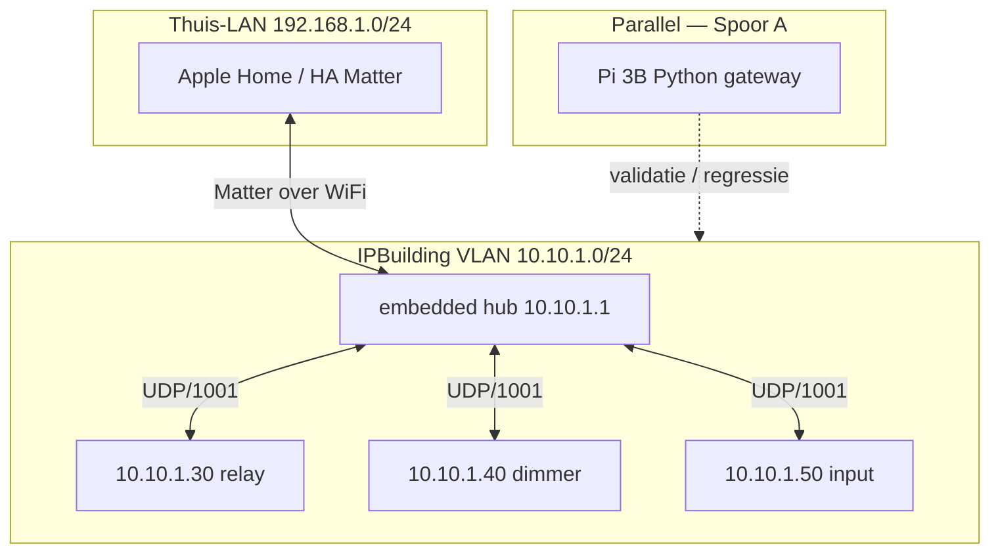

# Embedded IPBuilding Gateway — design spec

**Datum:** 2026-07-09  
**Type:** Design spec (nieuw product — Deployment C / Fase 12)  
**Status:** **Architect-review (ronde 1) afgerond op 2026-07-09; zie §14. E2 MVP gesloten 2026-07-12 (Apple Home), H1/H2 opgelost — zie §5.3, §14.**  
**Auteur:** agent-sessie + gebruikersbeslissingen (hardware besteld: ESP32-S3-ETH)  
**Scope:** standalone embedded hub die zelfstandig de veldbus-rol vervult (voorheen ingevuld door de IPBox, inmiddels door de Python-gateway op HA) en **Matter** als northbound exporteert. Geen Python-gateway naast het board in Gen 1.

**Relatie tot bestaand werk:**

| Repo / component | Rol | Status |
|------------------|-----|--------|
| [`IPBuilding-Gateway`](https://github.com/markminnoye/IPBuilding-Gateway) | Python gateway + RE + `gateway/payloads/` als **protocol-spec**; draait vandaag op de HA-installatie (Spoor A, huidige productie) | Shipping (v0.0.4) |
| [`ha-ipbuilding-gateway`](https://github.com/markminnoye/ha-ipbuilding-gateway) | HA companion (WS/REST) | Shipping — **niet** primair pad voor embedded Gen 1 |
| **`matter-esp32-ipbuilding-gateway`** (deze repo) | C++ ESP-IDF firmware: veldbus + Matter | Bevestigd tijdens architect-review 2026-07-09 als de definitieve embedded-firmware-repo |

Canonical northbound voor Python-gateway: [`ARCHITECTURE.md`](https://github.com/markminnoye/IPBuilding-Gateway/blob/main/ARCHITECTURE.md). Dit document **vervangt** die northbound voor het embedded product (Matter-only Gen 1).

---

## 1. Samenvatting (executive)

### Probleem

De originele IPBox is inmiddels **uitgeschakeld**. De veldbus-rol wordt vandaag ingevuld door de Python `IPBuilding-Gateway`, die draait op de HA-installatie (Spoor A) en de modules bereikt via **inter-VLAN routing** vanaf een ander VLAN — niet via het historische hub-adres `10.10.1.1`. Die Python-gateway praat WebSocket/REST met Home Assistant, maar heeft geen rechtstreeks pad naar moderne smarthome-platformen zoals **Apple Home**. Er is dus nood aan een hub die native **Matter** exporteert — **naast**, niet in plaats van, de bestaande HA-integratie.

### Beslissing

**Optie B — all-in-one embedded hub:** één firmware-image op ESP32-S3 die:

1. **Veldbus-hub** is (poll, commando’s, `B-…E` ontvangen) — port van `gateway/payloads/`
2. **Device registry** bijhoudt (subset van `devices.json` op flash)
3. **Matter-endpoints** exporteert (Gen 1: relay + dimmer; Gen 2: Generic Switch voor knoppen)

**Geen** Python-gateway, **geen** WebSocket/REST op het chip in Gen 1. Logica (scenes, automations) blijft in **Home Assistant** of **Apple Home**.

### Parallel spoor (niet blokkerend)

**Raspberry Pi 3B** draait de bestaande Python-gateway (Deployment B) voor snelle veldbus-validatie en regressie. Zie [`2026-06-14-deployment-hardware-evaluation.md`](https://github.com/markminnoye/IPBuilding-Gateway/blob/main/resources_and_docs/reference/2026-06-14-deployment-hardware-evaluation.md).

### Lab-hardware (bevestigd)

Gebruiker heeft besteld: **Waveshare ESP32-S3-ETH** (ESP32-S3R8 + W5500). Zie §5.

---

## 2. Doelstellingen en niet-doelen

### Doelen (Gen 1 MVP)

| # | Doel | Acceptatie |
|---|------|------------|
| G1 | Hub op `10.10.1.1`, UDP/1001 naar modules `.30/.40/.50` | Relay aan/uit + dimmer level werken fysiek; evidence-log |
| G2 | Statische config op flash (`devices.json` subset) | Herstart behoudt mapping; alleen actieve kanalen als Matter-endpoint |
| G3 | Matter northbound: **On/Off** (relay), **Level Control** (dimmer) | Commissioning via Apple Home; HA Matter als test-controller |
| G4 | Dual-homed netwerk: Ethernet = veldbus, WiFi = thuis-LAN | Zelfde patroon als Pi 3B (§4) |
| G5 | Dunne hub — geen IPBox-pariteit | Geen sferen, geen knop→relay mapping in firmware |

### Niet-doelen (Gen 1)

| Item | Reden |
|------|-------|
| WebSocket `/ws`, REST `/api/v1/` op chip | Northbound = Matter-only; Python-API blijft op Pi/HA add-on |
| Runtime ARP auto-discovery | MVP: handmatige `devices.json`; discovery = Fase embedded-2 |
| Cover/screen entities | Fase 11 in Python-roadmap; embedded later |
| EEPROM-sync / `saveAutonomy` | Fase 8; belangrijk voor IP1100-autonomie, niet MVP-blocker |
| Matter Generic Switch (IP1100 knoppen) | Gen 2 — zie §12 |
| Verplicht touch-UI / display | Gen 2; USB-serial debug volstaat voor Gen 1 |
| IPBox REST-shim `:30200` | Alleen Python-transitiepad |

---

## 3. Plaats in ecosysteem



**Drie sporen naast elkaar:**

| Spoor | Product | Doelgroep |
|-------|---------|-----------|
| **A** | HA add-on + companion | Primaire HA-installatie (shipping) |
| **B** | Pi 3B standalone Python | Snelle hub-validatie, mirror-captures |
| **C** | Embedded Matter hub (dit document) | Standalone hub in zekeringskast; Apple Home-first |

De companion (`ha-ipbuilding-gateway`) blijft relevant voor Spoor A/B. Voor Spoor C praat de gebruiker **rechtstreeks met Matter-controllers**; HA Matter-bridge is optionele testlaag.

---

## 4. Netwerk

### Topologie (verplicht patroon)

Identiek aan Pi 3B dual-homed ([`ARCHITECTURE.md`](https://github.com/markminnoye/IPBuilding-Gateway/blob/main/ARCHITECTURE.md) §3, hardware-eval §30–46):

```
ESP32-S3-ETH
├── eth (W5500)     → IPBuilding VLAN   10.10.1.1    UDP/1001 veldbus
└── wlan (onboard)  → thuis-LAN          192.168.1.x  Matter commissioning
```

### Operationele regels

| Regel | Detail |
|-------|--------|
| Hub-IP | `10.10.1.1` is vrij: de IPBox is uitgeschakeld en de huidige Python-gateway zit op een ander VLAN (bereikt de veldbus via inter-VLAN routing, niet via dit adres) — embedded hub kan `10.10.1.1` rechtstreeks binden, **geen conflict** |
| Python-gateway (Spoor A) | Blijft actief op de HA-installatie via inter-VLAN routing naar `10.10.1.0/24`; embedded hub is een onafhankelijk, parallel pad — geen IP-conflict, wel twee controllers die dezelfde modules kunnen aansturen (vergelijkbaar met twee lichtschakelaars op één circuit) |
| Hub-rol split (actuator-only) | Een hub kan relay/dimmer pollen en aansturen **zonder** input-modules te pollen — IP1100 blijft dan buiten slave-modus voor die hub (knoppen lokaal via EEPROM, of andere centrale pollt `I0000`). Zie §4.3 |
| UniFi | Eén Ethernet-kabel naar managed switch op IPBuilding-VLAN; PoE-levering op die poort **bevestigd** (§5.3 H3) |
| Firewall | Geen northbound-poort op chip; Matter gebruikt WiFi naar thuis-LAN |
| Mirror captures | Standaard `7←15` bij regressie ([playbook](https://github.com/markminnoye/IPBuilding-Gateway/blob/main/resources_and_docs/workflows/2026-05-14_relay_run_a_operational_playbook.md)) |

### 4.3 Hub-rol en coexistence (veldtest 2026-07-11)

Veldbus-hub-rol is **per moduletype configureerbaar** via poll-gedrag. De IP1100 (input) claimt een centrale alleen wanneer die hub `I0000` pollt; zonder input-poll blijven knoppen lokaal actief (EEPROM/autonoom) en komen er geen `B-…E`-events naar die hub.

| Modus | Poll | Effect |
|-------|------|--------|
| **Full hub** | relay + dimmer + input | Slave-modus; `B-…E` naar deze hub |
| **Actuators only** | relay + dimmer; **geen** input-poll | Relay/dimmer onder deze hub; inputs niet overgenomen |
| **Input delegated** | input alleen op andere centrale | Python gateway `managed: false` op input; embedded of legacy centrale ontvangt knoppen |

**Implementatie-prioriteit:** feature hoort primair in **Python gateway (Spoor B)** — [IPBuilding-Gateway #16](https://github.com/markminnoye/IPBuilding-Gateway/issues/16). Embedded firmware volgt in fase 2 (niet blokkerend voor E2).

**Veldtest-evidence:** [`2026-07-11-e1-input-listener.md`](../field-test/evidence/2026-07-11-e1-input-listener.md) — zonder input-poll geen `B-…E`; met poll press/release op `10.10.1.50`.

**Config-voorstel:** per-module `managed: true|false` of preset `hub_role: full|actuators_only`. **Implementatie-prioriteit:** Python gateway (Spoor B) eerst — [IPBuilding-Gateway #16](https://github.com/markminnoye/IPBuilding-Gateway/issues/16); embedded (Spoor C) in fase 2. Draft: [`2026-07-11-hub-role-feature-draft.md`](../field-test/evidence/2026-07-11-hub-role-feature-draft.md).

**Open RE:** exact IP1100-registratiemechanisme (hardcoded `10.10.1.1` vs learned-from-poll); dual-poller gedrag. PCAP aanbevolen.

### WiFi in zekeringskast

ESP32-S3-ETH heeft onboard ceramic antenna. **Opgelost (2026-07-12, H1):** productiekast is **kunststof**, geen metalen afscherming — geen RF-attenuatie te verwachten, externe antenne niet nodig.

---

## 5. Hardware

### 5.1 Bevestigde lab-hardware

| Eigenschap | ESP32-S3-ETH |
|------------|--------------|
| MCU | ESP32-S3R8 @ 240 MHz |
| RAM | 512 KB SRAM + **8 MB PSRAM** |
| Flash | 16 MB |
| Ethernet | W5500 (SPI) — 10/100 Mbps |
| Wireless | 2.4 GHz WiFi + BLE 5 |
| Voeding | USB-C (dev); PoE-module **optioneel** (niet besteld) |
| Wiki | [ESP32-S3-ETH](https://www.waveshare.com/wiki/ESP32-S3-ETH) |

**W5500 SPI-pinnen (board-default):** CS=14, INT=10, RST=9, MOSI=11, MISO=12, SCLK=13.

### 5.2 Hardware-matrix (besluitrecord)

| Profiel | Board | Wanneer |
|---------|-------|---------|
| **Lab / MVP** | **ESP32-S3-ETH** ✅ besteld | Firmware-ontwikkeling, veldbus + Matter |
| **Lab + PoE** | ESP32-S3-POE-ETH (+ module) | Test één-kabel deployment |
| **Productie zekeringskast** | **ESP32-S3-ETH** ✅ beslist (2026-07-12, H2) | Zelfde board als lab/MVP — geen DIN-rail board besteld |
| **Premium / Gen-2 UI** | ESP32-P4-WIFI6-POE-ETH | Meer RAM, native ETH, MIPI-DSI later |
| **Afgewezen** | ESP32-S3-RS485-CAN | Geen Ethernet — geen veldbus |
| **Afgewezen** | Touch-LCD / Relay-6CH boards | Geen veldbus-Ethernet of verkeerde rol |

Firmware **MOET** board-agnostisch zijn waar mogelijk: abstractielaag `BoardProfile` (ETH interface, optional PoE flag).

### 5.3 Hardware-vragen (architect) — opgelost

- [x] **H1 (opgelost 2026-07-12):** WiFi-bereik in de zekeringskast — kast is **kunststof**, geen metalen afscherming, geen RF-attenuatie-risico; externe antenne niet nodig.
- [x] **H2 (opgelost 2026-07-12):** Productie: **ESP32-S3-ETH** (het lab/MVP-board) is de productiehardware — geen DIN-rail board besteld.

**H3 (bevestigd 2026-07-09):** de UniFi-switch levert 802.3af PoE op de IPBuilding-VLAN-poort — geen verdere verificatie nodig, uit de open-vragenlijst gehaald.

---

## 6. Software-stack

| Laag | Keuze | Motivatie |
|------|-------|-----------|
| SDK | **ESP-IDF** ≥ 5.2 | Officieel Espressif; lwIP, dual-netif |
| Matter | **esp-matter** | `idf.py set-target esp32s3`; Apple Home ecosystem |
| Taal | C++17 | Consistent met ARCHITECTURE.md Deployment C |
| Build | `idf.py` + optional `esp-matter` submodule | Zelfde toolchain als Espressif docs |
| Config opslag | **LittleFS** of **SPIFFS** partitie | Statisch `devices.json` |
| Debug | USB-serial (115200) | Geen verplicht display Gen 1 |

**Niet gebruiken voor MVP:** Arduino, MicroPython, connectedhomeip direct (zonder esp-matter), Python op chip.

---

## 7. Architectuur firmware

### 7.1 Componentdiagram

```
┌─────────────────────────────────────────────────────────────┐
│                  embedded-ipbuilding-gateway                 │
│                                                              │
│  ┌──────────────┐   ┌─────────────────┐   ┌──────────────┐  │
│  │ ConfigStore  │   │ DeviceRegistry  │   │ MatterBridge │  │
│  │ (devices.json│◄──│ (runtime state) │──►│ esp-matter   │  │
│  │  on flash)   │   │                 │   │ endpoints    │  │
│  └──────────────┘   └────────┬────────┘   └──────▲───────┘  │
│                              │                    │          │
│                              ▼                    │ WiFi    │
│  ┌──────────────────────────────────────────┐    │          │
│  │           UdpBusManager (FreeRTOS task)   │    │          │
│  │  • poll loop (input ~2s, actuators ~20s)    │    │          │
│  │  • command queue                          │    │          │
│  │  • listener (input B-…E)                  │    │          │
│  │  • payloads/ (C++ port)                   │    │          │
│  └──────────────────────┬───────────────────┘    │          │
│                         │ eth (10.10.1.x)        │          │
└─────────────────────────┼────────────────────────┼──────────┘
                          ▼                        ▼
                   IP0200/0300/1100          Apple Home / HA Matter
```

### 7.2 Taken en prioriteiten (FreeRTOS)

| Task | Prioriteit | Cadans |
|------|------------|--------|
| `udp_bus_poll` | Hoog | input ~2 s, relay/dimmer ~20 s (configureerbaar) |
| `udp_bus_rx` | Hoog | Event-driven (socket) |
| `matter_stack` | Medium | esp-matter event loop |
| `config_load` | Laag | Boot + expliciete reload (later) |

### 7.3 Port van Python `gateway/payloads/`

Canonieke referentie-implementatie: [`gateway/payloads/`](https://github.com/markminnoye/IPBuilding-Gateway/tree/main/gateway/payloads).

| Module | Python bron | Embedded port |
|--------|-------------|---------------|
| Relay poll | `P0000`, decode status | `payloads/relay.cpp` |
| Relay command | `S`/`C` encode | idem |
| Dimmer | `D{ch}{level}`, ramp | `payloads/dimmer.cpp` |
| Input event | `B-…E` decode | `payloads/input.cpp` — **listener only Gen 1**; geen Matter export |

**Relay status (RE 2026-06-02):** `I<ch>` geeft geen kanaalstatus; status volgt na `S`/`C` of poll-reply. Embedded implementatie volgt Python-gedrag (Scenario B).

### 7.4 Device registry

In-memory structuur, geladen uit flash-config:

```json
{
  "modules": [
    {
      "ip": "10.10.1.30",
      "type": "relay",
      "channels": [
        { "ch": 0, "name": "Keuken LED", "active": true, "semantic_type": "light" }
      ]
    }
  ]
}
```

| Veld | Gen 1 gedrag |
|------|--------------|
| `active: false` | Geen Matter-endpoint; wordt **ook niet gepolld** op de veldbus (beslist A2 — bandbreedte/CPU sparen) |
| `name`, `room` | Matter endpoint naam / optional user-visible label |
| `semantic_type` | `light` → Matter On/Off Light; `fan` → Matter Fan; `switch` → Matter On/Off Plug-in Unit; dimmer-kanalen (los veld, geen `semantic_type`) → Dimmable Light (zie §8.1) |
| `ip`, `ch` | Veldbus routing |

**Entity-ID (intern):** `{ip}:{type}:{ch}` — zelfde conventie als Python `make_entity_id()`.

---

## 8. Matter northbound (Gen 1)

### 8.1 Endpoint-mapping

| Veldmodule | Matter device type | Clusters (minimaal) |
|------------|-------------------|---------------------|
| Relay kanaal (`semantic_type=light`) | On/Off Light | On/Off |
| Relay kanaal (`semantic_type=fan`) | Fan | On/Off (Fan Control) |
| Relay kanaal (`semantic_type=switch`) | On/Off Plug-in Unit | On/Off |
| Dimmer kanaal | Dimmable Light | On/Off, Level Control |
| Input (IP1100) | — | **Gen 2:** Generic Switch |

**Beslist (architect-review 2026-07-09, A1):** meerderheid van de relais zijn effectief lichten → `light`/On/Off Light. Twee kanalen sturen ventilatoren aan → apart `fan`-type/Matter Fan (correct icoon i.p.v. lamp). Eén kanaal is een pure stroomvoorziening (rookmelder) → `switch`/On/Off Plug-in Unit.

### 8.2 Commissioning

| Controller | Transport | Opmerking |
|------------|-----------|-----------|
| **Apple Home** | WiFi + BLE | Gebruiker commissiont via iPhone op thuis-LAN — **enige verplichte MVP-gate** |
| **Home Assistant Matter** | WiFi | Geen gate meer (A3 herzien 2026-07-12) — optioneel, niet vereist voor E2-acceptatie |

Matter-over-Ethernet is mogelijk op ESP32-S3-ETH; Gen 1 prioriteit blijft **WiFi** voor commissioning (Apple-ervaring).

### 8.3 Wat Matter **niet** vervangt

- Geen import van IPBox-projectdatabase
- Geen button→relay acties in hub — dat blijft HA automation of Apple Home automations
- Geen REST-shim voor legacy HA-IPBuilding

---

## 9. Configuratie en provisioning (Gen 1)

| Fase | Mechanisme |
|------|------------|
| **Gen 1** | Handmatig `devices.json` flashen (LittleFS image of `idf.py` upload) |
| **Gen 1.5** | USB-serial CLI of eerste-boot SoftAP om JSON te laden |
| **Gen 2** | Companion-achtige provisioning-tool (host-side) die JSON + Matter-fabric beheert |

**Bron voor initieel JSON:** export uit bestaande `devices.json` in [`IPBuilding-Gateway`](https://github.com/markminnoye/IPBuilding-Gateway/blob/main/devices.json) of `POST /api/v1/devices` van Python-gateway (Pi 3B).

### 9.1 Ethernet-provisioning (E3, issue #3)

Field-bus Ethernet (W5500) was tot en met E2 **hard static** op `10.10.1.1`. Vanaf E3: **factory default = DHCP met fallback naar static** — veel IPBuilding-VLANs hebben geen DHCP-server.

| Bestand | Rol |
|---------|-----|
| `network.json` (LittleFS, `config/network.json` bron) | `eth.mode`: `dhcp` (factory) of `static`; `dhcp_fallback_static` + `fallback_ip/netmask/gateway` |

**Boot-flow:**
1. `NetworkConfigStore::init()` laadt `network.json` (ontbreekt → factory default: dhcp + fallback `10.10.1.1/24`, gelijk aan de oude `CONFIG_ETH_STATIC_IP/GW/NETMASK`)
2. `network::init()` geeft die config door aan `init_ethernet()`: mode `dhcp` → wacht op `IP_EVENT_ETH_GOT_IP` (timeout 30 s) → geen lease → static fallback; mode `static` → direct toegepast, geen DHCP-poging
3. `udp_bus_manager::start()` bindt op het **effectieve** eth-IP (`network::get_eth_ip_info()`), niet meer op een hardcoded menuconfig-waarde — veldbus start dus altijd ná een bekend IP
4. Serial toont `ETH IP source: dhcp|fallback|static|none` en `UdpBusManager started on <ip>:1001 (source=…)`

**Voorbeelden:** [`config/examples/network.example.json`](../../../config/examples/network.example.json) (factory default) · [`config/examples/network.static-override.example.json`](../../../config/examples/network.static-override.example.json) (operator static override).

**Buiten scope (deze iteratie):** web-UI voor `network.json` (apart, issue #1); WiFi-provisioning blijft menuconfig.

---

## 10. Repository-structuur

**Repo:** deze repo, `matter-esp32-ipbuilding-gateway` (bevestigd tijdens architect-review 2026-07-09 als de definitieve embedded-firmware-repo — los van de Python-repo, geen submodule).

```
matter-esp32-ipbuilding-gateway/
├── README.md
├── AGENTS.md                   # agent brief (zoals IPBuilding-Gateway)
├── .gitignore
├── config/
│   ├── devices.json            # install config (gitignored, flashed to LittleFS)
│   └── examples/
│       └── devices.example.json
├── docs/
│   ├── README.md
│   ├── context-policy.md
│   ├── field-test/
│   │   └── README.md
│   └── superpowers/specs/
│       └── 2026-07-09-embedded-ipbuilding-gateway-design.md  # dit document
├── resources_and_docs/
│   ├── README.md
│   ├── evidence/               # embedded veldtestverslagen
│   ├── reference/              # links naar Python-repo
│   └── workflows/
├── sdkconfig.defaults          # esp32s3, PSRAM, partition table (E0)
├── partitions.csv              # nvs, phy, factory, littlefs (E0)
├── main/                       # firmware (E0+)
│   ├── CMakeLists.txt
│   ├── app_main.cpp
│   ├── board/
│   ├── config/
│   ├── registry/
│   ├── veldbus/
│   └── matter/
└── .github/workflows/ci.yml    # build-only (idf.py build) (E0)
```

**Sync-beleid met Python-repo (beslist A4, 2026-07-09):** puur documentair/handmatig — geen tooling of submodule. `gateway/payloads/` wijzigingen in IPBuilding-Gateway vereisen **expliciete** embedded-port + veldtest; geen automatische sync.

---

<a id="implementatiefasen"></a>

## 11. Implementatiefasen

### Fase E0 — Project bootstrap (agent-start)

| # | Taak | Done when |
|---|------|-----------|
| E0.1 | Skeleton-firmware opzetten in deze repo (`matter-esp32-ipbuilding-gateway`) | Skeleton buildt in CI |
| E0.2 | ESP-IDF + esp-matter hello op ESP32-S3-ETH | Serial log + chip-id |
| E0.3 | W5500 link-up op IPBuilding VLAN | LINK LED + ping vanaf LAN |
| E0.4 | Dual-netif: eth static `10.10.1.1`, WiFi STA thuis-LAN | Beide interfaces up |

### Fase E1 — Veldbus MVP

| # | Taak | Done when |
|---|------|-----------|
| E1.1 | Port `payloads/relay` + `payloads/dimmer` | Unit tests + loopback |
| E1.2 | UDP poll naar `10.10.1.30` / `.40` | PCAP of mirror bevestigt `P0000` |
| E1.3 | Relay `S`/`C` + dimmer level command | Fysiek licht schakelt |
| E1.4 | `devices.json` laden van LittleFS | Alleen `active:true` kanalen in registry |
| E1.5 | Input listener `B-…E` (log only) | Serial log bij druk knop |

**Acceptatie:** veldtest-document vergelijkbaar met [`2026-06-01_gateway_field_test.md`](https://github.com/markminnoye/IPBuilding-Gateway/blob/main/resources_and_docs/evidence/2026-06-01_gateway_field_test.md).

### Fase E2 — Matter MVP

| # | Taak | Done when |
|---|------|-----------|
| E2.1 | esp-matter bridge: 1 relay endpoint | Apple Home schakelt 1 kanaal |
| E2.2 | Alle actieve relay + dimmer endpoints | Commissioning + on/off + dim |
| E2.3 | State sync: veldbus → Matter attribute | Status match na poll |
| E2.4 | Command path: Matter → veldbus | Toggle vanuit Apple Home |

**Acceptatie:** screen recording of testverslag; geen companion vereist. E2 vereist succesvolle commissioning + bediening in **Apple Home** (A3 herzien 2026-07-12, zie §8.2) — **gesloten**, zie [`e2-matter-checklist.md`](../field-test/e2-matter-checklist.md) en evidence [`2026-07-12-e2-matter-mvp.md`](../field-test/evidence/2026-07-12-e2-matter-mvp.md).

### Fase E3 — Hardening (post-MVP)

- Optionele bind-recovery voor `10.10.1.1` (bv. als per ongeluk twee hub-instanties tegelijk actief zijn — geen conflict met de Python-gateway zelf, zie §4/§13)
- Watchdog + crash logging
- OTA (esp-matter OTA)
- PoE-module test (hardware upgrade)

### Fase E4 — Gen 2 (deferred)

| Feature | Beschrijving |
|---------|--------------|
| Matter Generic Switch | IP1100 knoppen als routeerbare events |
| Runtime discovery | lwIP ARP monitor (port van `auto_discovery.py` concept) |
| EEPROM-sync | HTTP `saveAutonomy` naar IP1100 |
| Touch UI | ESP32-P4 + MIPI-DSI of apart wandpaneel |
| Cover entities | Relay-paren |

---

## 12. Parallel spoor A — Pi 3B

| Aspect | Detail |
|--------|--------|
| Doel | Veldbus-regressie terwijl embedded firmware rijpt |
| Effort | ~0,5–2 dagen ([hardware-eval](https://github.com/markminnoye/IPBuilding-Gateway/blob/main/resources_and_docs/reference/2026-06-14-deployment-hardware-evaluation.md)) |
| Relatie | Geen code-shared; **wel** gedeelde `devices.json` en payload-semantiek |
| Wanneer stoppen | Embedded E2 acceptatie + 48h stabiele veldbus |

---

## 13. Risico's

| Risico | Impact | Mitigatie |
|--------|--------|-----------|
| esp-matter RAM/flash footprint | Build faalt of OTA krap | `sdkconfig` optimalisaties; start met weinig endpoints |
| W5500 SPI + Matter + WiFi concurrent | Poll jitter | Dedicated task; meet poll-latency in E1 |
| ~~WiFi in metalen kast~~ | — | **Niet van toepassing** — productiekast is kunststof (§5.3 H1, opgelost 2026-07-12) |
| Onbedoeld dubbele hub-binding | Twee actieve controllers op dezelfde modules | Geen IP-conflict (IPBox is uit, Python-gateway zit op ander VLAN — §4/A7); gelijktijdige bediening via HA + Apple Home is normaal gedrag, geen bug |
| Payload drift Python ↔ C++ | Regressie | Gedeelde testvectoren uit `tests/test_payloads*.py` |
| Geen HA companion op embedded | Gebruiker verwacht WS | Duidelijke productcommunicatie: Matter-first |

---

## 14. Beslissingen — architect-review 2026-07-09

Onderstaande punten waren **open** in de eerste draft en zijn tijdens de architect-review met de gebruiker afgeklopt:

| ID | Vraag | Beslissing |
|----|-------|------------|
| **A1** | Matter device type per relay kanaal | `light` → On/Off Light, `fan` → Fan, `switch` → On/Off Plug-in Unit (zie §8.1) |
| **A2** | Poll `active:false` kanalen? | **Nee** — niet pollen, geen Matter-endpoint (zie §7.4) |
| **A3** | Gen 1 HA-pad | ~~HA Matter is een **verplichte** MVP-gate naast Apple Home~~ — **herzien 2026-07-12:** Apple Home is het enige verplichte controllerpad; HA Matter is out of scope (zie §8.2) |
| **A4** | Repo-koppeling | Losse repo (deze repo, `matter-esp32-ipbuilding-gateway`); sync met Python-repo blijft puur documentair/handmatig (zie §10) |
| **A5** | Northbound na Gen 1 | Matter-only; geen vooruitplanning voor MQTT/REST tenzij een concrete need opduikt |
| **A6** | Productie-hardware gate | **Beslist 2026-07-12 (na E2-acceptatie):** ESP32-S3-ETH (lab/MVP-board) is de productiehardware — geen DIN-rail board (zie §5.3 H2) |
| **A7** | Netwerkrealiteit veldbus | IPBox is uitgeschakeld; Python-gateway (Spoor A) zit op een ander VLAN en bereikt de veldbus via inter-VLAN routing — **geen** IP-conflict met de embedded hub op `10.10.1.1` (zie §4) |

**Alles gesloten:** §5.3 **H1** en **H2** opgelost 2026-07-12; A3 herzien (HA Matter uit scope); E2 MVP gesloten.

---

## 15. Agent-start checklist

Wanneer architect dit document **goedkeurt**, mogen agenten starten met:

1. **E0.1** — skeleton-firmware opzetten per §10 (deze repo)
2. **Lezen:** [`gateway/payloads/`](https://github.com/markminnoye/IPBuilding-Gateway/tree/main/gateway/payloads), [`RE_STATE.md`](https://github.com/markminnoye/IPBuilding-Gateway/blob/main/resources_and_docs/RE_STATE.md), [`IPBUILDING_KNOWLEDGE.md`](https://github.com/markminnoye/IPBuilding-Gateway/blob/main/resources_and_docs/IPBUILDING_KNOWLEDGE.md) §10.5
3. **Niet starten:** companion-wijzigingen, EEPROM-sync, discovery, touch UI
4. **Hardware:** ESP32-S3-ETH. Geen IPBox-uitschakeling nodig (al inactief) — controleer enkel dat er geen andere listener op `10.10.1.1` actief is voor veldtest
5. **Evidence:** elk veldtest-resultaat in `resources_and_docs/evidence/` (deze repo) of verwijs naar Python-repo evidence bij gedeelde veldbus-tests

**Blocked tot goedkeuring:** firmware-implementatie in productie-repo; wel voorbereidende doc/sync in IPBuilding-Gateway.

---

## 16. Referenties

| Document | Inhoud |
|----------|--------|
| [`ARCHITECTURE.md`](https://github.com/markminnoye/IPBuilding-Gateway/blob/main/ARCHITECTURE.md) | Canonical Python-gateway architectuur |
| [`AGENTS.md`](https://github.com/markminnoye/IPBuilding-Gateway/blob/main/AGENTS.md) | Agent-brief en roadmap |
| [`2026-06-14-deployment-hardware-evaluation.md`](https://github.com/markminnoye/IPBuilding-Gateway/blob/main/resources_and_docs/reference/2026-06-14-deployment-hardware-evaluation.md) | Pi / ESP32 hardware besluiten |
| [`2026-05-17_ipbuilding_fieldbus_capability_matrix.md`](https://github.com/markminnoye/IPBuilding-Gateway/blob/main/resources_and_docs/2026-05-17_ipbuilding_fieldbus_capability_matrix.md) | Veldbus capabilities |
| [`gateway/payloads/`](https://github.com/markminnoye/IPBuilding-Gateway/tree/main/gateway/payloads) | Protocol codecs (port-source) |
| [`docs/api/websocket.md`](https://github.com/markminnoye/IPBuilding-Gateway/blob/main/docs/api/websocket.md) | Referentie only — niet geïmplementeerd op chip Gen 1 |
| [ESP32-S3-ETH Wiki](https://www.waveshare.com/wiki/ESP32-S3-ETH) | Board pinout, Ethernet demo |
| [esp-matter ESP32-S3](https://docs.espressif.com/projects/esp-matter/en/latest/esp32/) | Matter SDK |

---

## Changelog

| Datum | Wijziging |
|-------|-----------|
| 2026-07-09 | Eerste draft — brainstorm + hardware ESP32-S3-ETH besteld |
| 2026-07-09 | Architect-review ronde 1: A1–A7 beslist (§14), repo-identiteit bevestigd (deze repo), `semantic_type` uitgebreid met `fan`, netwerkrealiteit gecorrigeerd (IPBox uit, Python-gateway op ander VLAN via inter-VLAN routing, geen conflict), alle repo-relatieve links vervangen door absolute GitHub-URL's. H2 (productiebord) blijft open. |
| 2026-07-12 | E2 Matter MVP gesloten (Apple Home commissioning + on/off + dim + state sync bidirectioneel, fysiek geverifieerd). A3 herzien: HA Matter is geen MVP-gate meer, out of scope. H1 opgelost (kunststof kast, geen antenne-risico). H2 opgelost (ESP32-S3-ETH is productiehardware, geen DIN-rail board). |
